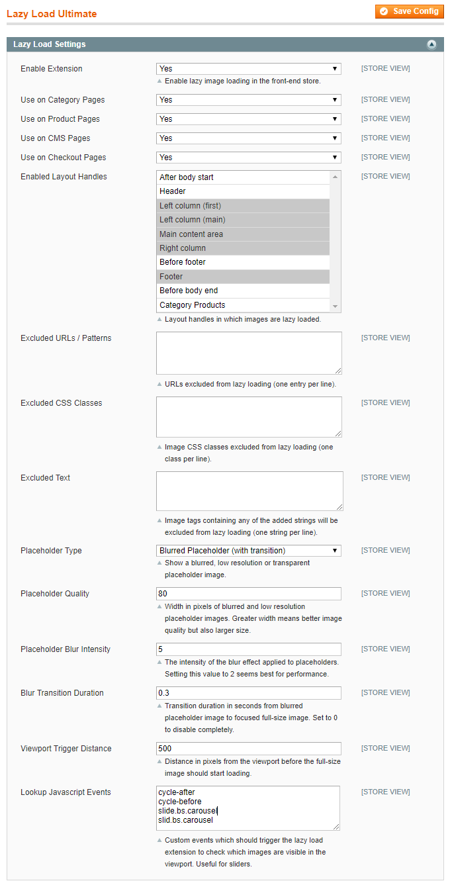

# Configuring Lazy Load Ultimate

To configure the extension, navigate to **System > Configuration** in the top Admin Panel and select **Lazy Load Ultimate** from the left side menu.

Using the extension's config screen you can enable lazy image loading for various store pages and layout handles and modify the placeholder image settings.

It’s possible to configure the extension per store view by changing the ‘Current Configuration Scope’ at the top left corner of the page.

To save any changes made in the Lazy Load Settings, click the ‘Save Config’ button in the top right corner of the configuration page.

## Lazy Load Settings

Using the Lazy Load Settings you can:

- Enable the extension and choose to use lazy image loading on category pages, product pages, CMS pages and check-out pages.
- Select the front-end layout handles in which lazy image loading should be enabled.
- Enter the URLs / patterns, image CSS classes and image tag strings which should be excluded from lazy image loading (one URL / class / string per line).
- Select a placeholder image type, choosing to show a transparent, blurred or low resolution placeholder. If the blurred or low resolution placeholder type is selected, you can configure the image quality which is defined by its width in pixels and by default set to 80 (px). A greater width means a better placeholder image quality but also a larger image size, slowing down the loading of pages. If the blurred placeholder type is selected, you can specify the blur intensity and blur transition duration of placeholder images, which by default are set to 5 and 0.3 (seconds). A greater blur intensity number will intensify the blur effect of placeholder images. If the low resolution placeholder type is selected, you can choose to show a blurred or pixelated placeholder image.
- Configure the viewport trigger distance in pixels, which by default is set to 500(px) and defines the distance from the visible store page area before images start loading.
- Enter custom lookup Javascrip events which should trigger lazy loading to check which images are visible in the viewport, which is useful for sliders.

---

[Documentation index](./README.md) · [README](../README.md) · [Online version](https://plugin.company/knowledge-base/docs/magento-lazy-load-ultimate/user-manual/configuring-lazy-load-ultimate/)
