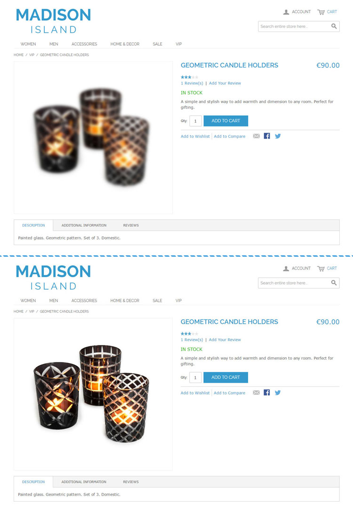

# Lazy Load Front-end Examples

Below are front-end examples of the Lazy Load Ultimate extension used on various Magento store pages.

## Lazy CMS Page Loading

Example of lazy image loading on a Magento CMS / home page.

## Lazy Category Page Loading

Example of lazy image loading on a Magento category page.

## Lazy Product Page Loading

Example of lazy image loading on a Magento product page.

## Lazy Checkout Page Loading

Example of lazy image loading on a Magento checkout page.

---

[Documentation index](./README.md) · [README](../README.md) · [Online version](https://plugin.company/knowledge-base/docs/magento-lazy-load-ultimate/user-manual/lazy-load-frontend-examples/)
